<p align="center">
  
</p>

### `$ whoami`

Desenvolvedor Full Stack com foco em Python e IA generativa, formado em Engenharia de Software.
Construo sistemas de ponta a ponta, do banco de dados ao deploy. Hoje sou Product Owner e
desenvolvedor na Fábrica de Software da Polícia Militar do Estado de São Paulo (PMESP).

### `$ ls ~/projetos`

| Projeto | O que é | Stack |
|---|---|---|
| [**NetAdmin**](https://github.com/Leonardo-Richeto/netadmin-pmesp) | Sistema web que gerencia os links de intranet de cerca de 2.100 unidades da PMESP. Unificou um fluxo antes dividido em 5 sistemas. Em produção desde jul/2026. | FastAPI · PostgreSQL · React 19 · TypeScript · Docker |
| [**Agente de IA para WhatsApp**](https://github.com/Leonardo-Richeto/agente-ia-whatsapp) | Plataforma multiempresa em que um agente LLM com function calling e 19 ferramentas consulta o catálogo, monta pedidos e agenda horários. | FastAPI · OpenAI API · pgvector · Redis · React |
| [**Auto Dieta**](https://github.com/Leonardo-Richeto/auto-dieta-api) | API REST de calorias, macronutrientes e dietas, com front-end em React (2024). | Node.js · Express · MySQL · React |

> O código do NetAdmin e do agente são privados.

### `$ cat stack.txt`

```text
backend    Python · FastAPI · SQLAlchemy · Pydantic · Alembic · Node.js · Express
ia         LLMs · OpenAI API · function calling · RAG · embeddings · pgvector · evals
frontend   React · TypeScript · Vite · React Hook Form · Zod
dados      PostgreSQL · Redis · MySQL
devops     Docker · Docker Compose · Nginx · Linux · GitHub Actions
testes     pytest · Testcontainers · Vitest · Testing Library
```

### `$ git log --oneline carreira`

```text
2026-08  Product Owner e desenvolvedor · Fábrica de Software, PMESP
2026-07  NetAdmin entra em produção
2025-03  Administração de Redes · Diretoria de TI (DTIC), PMESP
2025     Bacharelado em Engenharia de Software · UniCesumar
2012     Policial militar · PMESP
```

### `$ contato`

[LinkedIn](https://www.linkedin.com/in/leonardo-richeto-183a37215) ·
[leonardoricheto@gmail.com](mailto:leonardoricheto@gmail.com)
